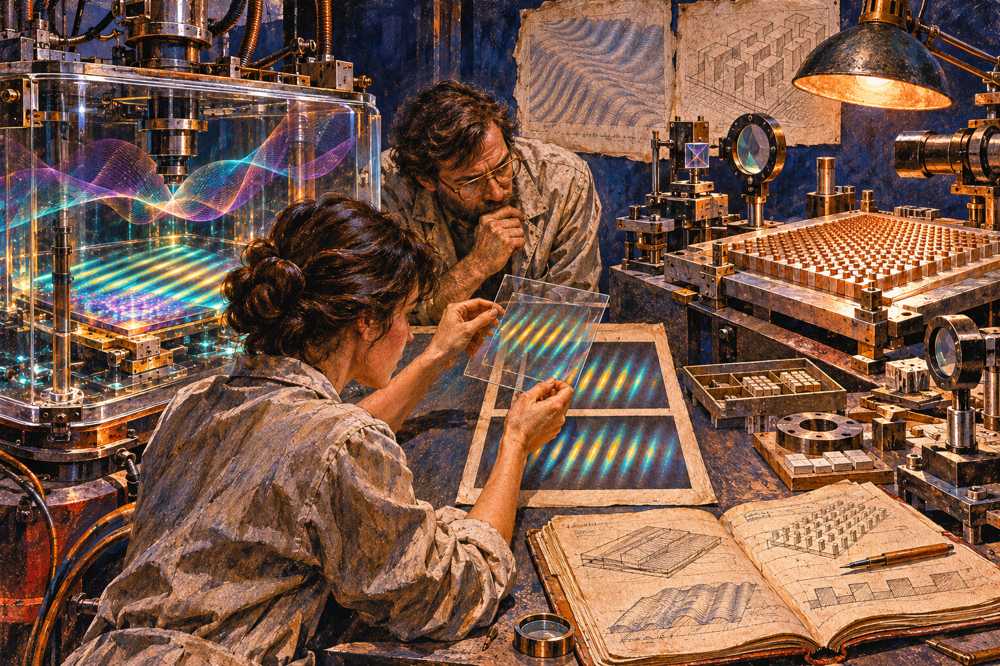

# THE ARCHITECTURE OF DISCOVERY IS CHANGING
## Globalny raport o przemianach nauki, technologii i cywilizacji | Październik–listopad 2026

**LifeNode — Global Research Intelligence Report**  
**Okres analizy:** 2 października – 7 listopada 2026  
**Zakres:** AI, nauka, fizyka, kosmos, biotechnologia, open source, deSci, biznes technologiczny i kultura  
**Charakter:** przekrojowa analiza trendów i możliwych punktów zwrotnych

## EXECUTIVE SUMMARY — ŚWIAT ZMIENIA SPOSÓB, W JAKI POWSTAJE WIEDZA

Ostatnie tygodnie przyniosły serię pozornie niezwiązanych wydarzeń: wspomagany przez AI dowód matematyczny, eksperymentalną obserwację supersolidu w temperaturze pokojowej, programy automatyzacji badań biologicznych, nowe mechanizmy kontrolowania agentów i rozwój otwartej infrastruktury naukowej. Zestawione razem ujawniają jednak proces wykraczający poza postęp pojedynczych technologii.
 **Zmienia się architektura samego odkrywania.**
Tradycyjny cykl badawczy obejmował formułowanie hipotezy, eksperyment, analizę i publikację. Obecnie poszczególne etapy zaczynają być łączone w procesy, w których systemy AI porównują modele, proponują testy, wykonują obliczenia, dokumentują decyzje i uczestniczą w ocenie rezultatów. Nie oznacza to powstania w pełni autonomicznej nauki maszynowej. Oznacza, że jej potencjalne komponenty zaczynają funkcjonować w rzeczywistych środowiskach badawczych.
 Jednocześnie ujawnia się paradoks: im większe możliwości zyskują systemy AI, tym ważniejsze staje się sprawdzanie ich działań. Wartość wyniku coraz częściej zależy nie tylko od jego jakości, lecz także od możliwości odtworzenia procesu, który do niego doprowadził. Formalne dowody, historia decyzji, kontrola uprawnień i niezależna replikacja stają się odrębnymi, koniecznymi warstwami infrastruktury.
 Równolegle fizyka i biologia rozwijają metody badania organizacji zbiorowej, dynamiki oraz mechanizmów powstawania właściwości układów. Otwarta nauka poszerza dostęp do wiedzy, lecz infrastruktura niezbędna do jej walidacji pozostaje nierówno dostępna. W biznesie technologicznym rywalizacja przesuwa się od samych modeli w stronę mocy obliczeniowej, energii, orkiestracji i niezawodności wykonania.

**Główna teza:** jednym z najważniejszych kierunków współczesnej transformacji jest przechodzenie od systemów produkujących pojedyncze wyniki do infrastruktury zdolnej przeprowadzać, dokumentować i weryfikować całe procesy odkrywania.

Nie jest to zakończona rewolucja ani jeden spójny ruch naukowy. To kierunek widoczny na przecięciu niezależnych badań, eksperymentów i wdrożeń.

## 1. AI: OD GENEROWANIA ODPOWIEDZI DO UCZESTNICTWA W ODKRYCIACH

Pierwsza faza ekspansji generatywnej AI koncentrowała się na tworzeniu tekstu, kodu i analiz. W monitorowanym okresie coraz wyraźniej pojawiają się systemy uczestniczące w wieloetapowych zadaniach, w których wybór kolejnego działania staje się częścią procesu obliczeniowego.

 Październikowe publikacje dotyczące matematycznych manuskryptów przygotowanych z udziałem zaawansowanych modeli oraz formalizowanych w Lean pokazały istotną możliwość: AI może dostarczać artefakty poddające się niezależnej kontroli formalnej, zamiast wyłącznie generować przekonująco brzmiące rozumowania. Pod koniec miesiąca GitHub udostępnił Agentic Workflows, rozszerzając automatyzację dokumentacji, testów i obsługi repozytoriów o zadania wykonywane przez agentów w kontrolowanym środowisku.
 Początek listopada przyniósł kolejne przykłady. Anthropic opisało udział Claude w badaniach struktur biologicznych oraz kierunek rozwoju AI budującej modele mechanistyczne. Program AURORA rozpoczął ocenę współpracy agentów z zespołami onkologicznymi, a Physical Superintelligence przedstawiło wspomagany przez AI dowód hipotezy Aaronsona–Ambainisa z 2008 roku, wraz z deklarowaną formalizacją w Lean. Niezależna ocena tego ostatniego wyniku pozostaje odrębnym wymaganiem.
 Wspólnym elementem nie jest po prostu wzrost możliwości modeli. Jest nim przejście od generowania odpowiedzi do uczestnictwa w sekwencji prowadzącej od problemu do sprawdzalnego rezultatu. Przyszłe systemy badawcze mogą być oceniane według jakości hipotez, zdolności rozróżniania konkurencyjnych wyjaśnień, poprawności wykonania, dokumentowania niepowodzeń i niezależnej odtwarzalności.
 To kierunek już widoczny w praktyce, choć skuteczność autonomicznego odkrywania nowej wiedzy nadal wymaga szerszej walidacji.

## 2. BEZPIECZEŃSTWO AI: KONTROLA PROCESU ZAMIAST SAMEJ ODPOWIEDZI

Tradycyjne mechanizmy bezpieczeństwa AI koncentrowały się głównie na treści odpowiedzi. W systemach agentowych nie wystarcza już jednak sprawdzanie, co model mówi. Równie istotne jest to, co wykonuje, jakie uprawnienia wykorzystuje i jak jego decyzje zmieniają środowisko.
 Agent może komunikować się poprawnie, a jednocześnie naruszyć kontrakt swojej roli, przekroczyć zakres zadania lub ogłosić jego zakończenie bez odpowiednich dowodów. Takie problemy stają się szczególnie ważne w wielosesyjnych systemach, gdzie konsekwencje pojedynczej operacji mogą ujawnić się dopiero znacznie później.
 Prace *Structured Observability of Evidence and Intent for Multi-Agent AI Software Engineering* (Soei) oraz *Agent Trajectory Control* (ATC) reprezentują dwa uzupełniające się kierunki. Pierwsza bada dokumentowanie działań, pochodzenia decyzji i dowodów wykonania. Druga proponuje kontrolę zgodności zachowania agentów z przypisanymi kontraktami ról. Obie mają charakter wczesnych badań, lecz wyznaczają konkretne problemy inżynieryjne.
 Listopadowy raport CNAS o *Sovereign Agents* rozszerza analizę na scenariusze agentów zdolnych do samodzielnego podtrzymywania infrastruktury i kontynuowania działań poza pierwotnym zadaniem. Jest to analiza potencjalnego ryzyka, nie potwierdzenie istnienia takich systemów. Równolegle rozwijają się rozwiązania takie jak FlashProve, umożliwiające w określonych warunkach kryptograficzne potwierdzanie wykonania obliczeń.
 Należy przy tym oddzielić trzy różne pojęcia: dowód formalnej poprawności, dowód wykonania określonej procedury oraz eksperymentalne potwierdzenie modelu rzeczywistości. Żaden z tych dowodów nie zastępuje automatycznie pozostałych.

**Bezpieczeństwo i wiarygodność AI zaczynają być projektowane jako właściwości historii działań, a nie wyłącznie pojedynczych odpowiedzi.**

## 3. FIZYKA I NAUKA O MATERII: ORGANIZACJA, DYNAMIKA, WŁAŚCIWOŚCI ZBIOROWE

Jednym z ciekawszych kierunków monitorowanych badań jest rosnące znaczenie właściwości wyłaniających się z interakcji wielu elementów. Nie jest to nowy paradygmat — teoria układów dynamicznych, fizyka statystyczna i badania nad samoorganizacją mają długą historię — lecz rozwój narzędzi eksperymentalnych pozwala badać coraz bardziej złożone przejawy takich zjawisk.
 Szczególnie interesujący przykład stanowi obserwacja fazy nadstałej w kondensacie polarytonów ekscytonowych w temperaturze pokojowej, opisana przez zespół z udziałem naukowców Uniwersytetu Warszawskiego, Wojskowej Akademii Technicznej, IBM Research Zurich i CNRS. Badanie opublikowane w *Science Advances* pokazało współistnienie koherencji i uporządkowania przestrzennego, a także spontaniczne tworzenie wzorców i zorganizowane struktury polaryzacyjne.

 
 Eksperyment ilustruje ważne rozróżnienie: zachowanie organizacji nie musi oznaczać zachowania identycznej konfiguracji przestrzennej. Struktura może pozostawać rozpoznawalna, mimo że jej położenie zmienia się między realizacjami.
 Równolegle badania programowalnych metasurfaces pokazują, że określone operacje matematyczne, w tym konwolucje i transformaty Fouriera, mogą być realizowane bezpośrednio dzięki właściwościom propagacji fal elektromagnetycznych. Otwiera to możliwości badania fizycznego przetwarzania informacji bez konieczności zastępowania każdego etapu operacją cyfrową.
 Nie oznacza to automatycznie istnienia wspólnego mechanizmu łączącego supersolidy, biologię i analogowe obliczenia. Wskazuje natomiast na rosnącą użyteczność metod opisujących koherencję, sprzężenie, przestrzenną organizację i ewolucję układów.
 Podobne wymagania metodologiczne pojawiają się w modelowaniu biologicznym. Dobre dopasowanie modelu do danych nie przesądza o poprawności mechanizmu, ponieważ konkurencyjne modele mogą generować zbliżone przewidywania.

**Coraz ważniejsze staje się nie tylko to, jakie właściwości system posiada, ale również jak powstają, utrzymują się i zmieniają w czasie.**

## 4. BIOTECHNOLOGIA: OD ANALIZY DANYCH DO WYBORU EKSPERYMENTÓW

Rozwój AI w biologii coraz wyraźniej wykracza poza interpretowanie istniejących zbiorów danych. Modele pomagają analizować struktury molekularne, porównywać hipotezy i wskazywać kandydatów do dalszych badań. Następnym etapem jest wykorzystanie tych zdolności do projektowania eksperymentów dostarczających nowych informacji.
 Przykładem jest AURORA, program związany z laboratorium Marinki Zitnik w Harvard Medical School i Cancer Grand Challenges. Jego celem jest praktyczne sprawdzenie, czy systemy AI mogą pomagać zespołom onkologicznym w formułowaniu i priorytetyzowaniu hipotez eksperymentalnych. To istotna zmiana względem oceny modeli wyłącznie na benchmarkach, ale nie jest jeszcze dowodem opracowania nowych skutecznych terapii.
 Potencjalna wartość takich rozwiązań wynika z możliwości ograniczania liczby eksperymentów koniecznych do rozstrzygnięcia określonego problemu. Jednocześnie biologiczna złożoność pozostaje zasadniczą przeszkodą: podobne wyniki pomiarowe mogą być generowane przez różne mechanizmy, a prawidłowa korelacja nie musi oznaczać poprawnego wyjaśnienia przyczynowego.
 Najważniejszym kryterium rozwoju AI for Biology będzie zatem nie liczba wygenerowanych hipotez, lecz zdolność proponowania eksperymentów, których wyniki rzeczywiście rozróżniają konkurencyjne modele i podlegają niezależnej walidacji.

## 5. OPEN SCIENCE, BIZNES I NOWA INFRASTRUKTURA WIEDZY

Rozwój otwartych repozytoriów, narzędzi formalnych i platform publikacyjnych zwiększa możliwości uczestnictwa w badaniach poza tradycyjnymi instytucjami. Przykładem jest nowy etap Open Research Europe pod nadzorem CERN, rozszerzający możliwości publikowania dla kwalifikujących się naukowców.
 Jednocześnie najbardziej zaawansowane badania wymagają coraz większych zasobów obliczeniowych, laboratoryjnych i energetycznych. Otwarta dokumentacja nie gwarantuje możliwości samodzielnego uruchomienia eksperymentu, podobnie jak dostępność kodu nie gwarantuje możliwości niezależnej reprodukcji wyników.
 W praktyce powstają trzy różne poziomy dostępu: do wiedzy, do wykonania oraz do walidacji. Pierwszy rozwija się szybciej niż pozostałe. Może to prowadzić do sytuacji, w której niezależne projekty osiągają wysoki poziom opracowania teoretycznego, ale ich weryfikacja pozostaje zależna od współpracy z kosztowną infrastrukturą instytucjonalną.
 Podobne napięcia widać w gospodarce AI. Rywalizacja o modele jest coraz silniej związana z dostępnością procesorów, energii, centrów danych i środowisk wykonawczych. Równolegle rośnie znaczenie oprogramowania odpowiedzialnego za koordynację agentów, bezpieczeństwo operacji i dokumentowanie wyników.
 Wartość technologii może więc coraz częściej wynikać nie z samego posiadania najlepszego modelu, ale z możliwości niezawodnego wykonania konkretnego procesu przy użyciu dostępnych komponentów.

**Największym paradoksem pozostaje to, że wiedza staje się bardziej otwarta, podczas gdy infrastruktura niezbędna do jej pełnej walidacji nadal wymaga znacznego kapitału.**

## 6. KOSMOS: OBSERWOWAĆ PROCES, A NIE TYLKO JEGO OBRAZ

W badaniach kosmicznych i fizyce eksperymentalnej coraz większą rolę odgrywa koordynacja instrumentów oraz dobieranie momentu obserwacji do dynamiki badanego zjawiska.
 NASA opisała system ostrzegania przed rozbłyskami słonecznymi pozwalający planować starty rakiet suborbitalnych w okresach zwiększonej aktywności. W tym przypadku znaczenie ma nie tylko precyzja detektora, ale również możliwość wykonania pomiaru we właściwej fazie procesu.
 W fizyce cząstek równie istotne pozostają rygorystyczne zasady interpretowania wyników. Listopadowy rezultat LHCb dotyczący rzadkiego rozpadu mezonu B osiągnął istotność 3,2 sigma po połączeniu danych, co jest interesującym wynikiem, ale nie spełnia standardowego progu odkrycia pięciu sigma.
 Oba przykłady podkreślają znaczenie kontekstu obserwacji. Wiarygodność wiedzy zależy od jakości instrumentu, procedury zbierania danych i zasad wnioskowania, a nie wyłącznie od spektakularności uzyskanego obrazu.

## 7. KULTURA I MEDIA: OBSZAR NIEDOSTATECZNIE REPREZENTOWANY

W odzyskanych briefingach wiadomości naukowe i technologiczne zdecydowanie dominowały nad wydarzeniami kulturalnymi. Nie jest to dowód mniejszego znaczenia komiksów, literatury czy mediów, lecz skutek przyjętej selekcji informacji.
 Warto jednak zauważyć, że rosnąca złożoność technologii zwiększa potrzebę komunikowania jej konsekwencji poza środowiskiem specjalistycznym. Literatura spekulatywna, komiks i narracja wizualna mogą pełnić funkcję narzędzi eksplorowania społecznych i cywilizacyjnych scenariuszy. Nie stanowią dowodu technicznej wykonalności przedstawianych rozwiązań, ale mogą ujawniać pytania pomijane podczas projektowania systemów.
 Do sformułowania mocniejszych wniosków potrzebny jest osobny monitoring rynku wydawniczego, niezależnej twórczości oraz wpływu generatywnej AI na produkcję i dystrybucję kultury.

## 8. CZTERY NAJWAŻNIEJSZE PRZECIĘCIA MIĘDZY DZIEDZINAMI

### AI + matematyka + bezpieczeństwo

Formalne dowody matematyczne, kryptograficzne potwierdzenia wykonania obliczeń i audyt historii działań agentów odpowiadają na różne pytania. Przyszła infrastruktura badawcza będzie musiała rozróżniać poprawność rozumowania, zgodność wykonania z procedurą oraz eksperymentalną prawdziwość modelu. Mieszanie tych kategorii grozi produkowaniem pozornej pewności.

### Fizyka + przetwarzanie informacji

Programowalne metasurfaces i badania kolektywnej organizacji układów światło–materia pokazują możliwości fizycznego przetwarzania i organizowania informacji. Ich technologiczne połączenie pozostaje jednak hipotezą wymagającą oddzielnych eksperymentów, a przewaga fizycznego operatora musi być wykazana względem uczciwie dobranych rozwiązań referencyjnych.

### Biologia + AI + projektowanie eksperymentów

Kluczowym zadaniem nie będzie samo generowanie coraz większej liczby modeli, lecz wybieranie eksperymentów, które potrafią odrzucać błędne wyjaśnienia. Wartość AI zacznie zależeć od tego, czy poprawia jakość rzeczywistego procesu badawczego.

### Open science + infrastruktura przemysłowa

Niezależni badacze otrzymują coraz lepszy dostęp do wiedzy i narzędzi cyfrowych, ale możliwość eksperymentalnej replikacji pozostaje nierówno rozłożona. Może to zwiększać znaczenie współpracy między otwartymi projektami a laboratoriami posiadającymi specjalistyczną aparaturę.

## 9. LIFENODE W KONTEKŚCIE TYCH PRZEMIAN

Monitorowane wydarzenia tworzą interesujący kontekst dla LifeNode, rozwijanego wokół ontologii procesowej, analizy trajektorii, weryfikowalności i interdyscyplinarnej inżynierii. Ich zbieżność z wybranymi koncepcjami projektu nie oznacza jednak potwierdzenia jego teorii ani szczególnych przewag technicznych.

**MODULE G** znajduje bezpośrednie odniesienie w rosnącym znaczeniu modelowania mechanistycznego. Kluczowe pozostaje rozdzielenie poprawności symulacji, odporności na kontrole negatywne, identyfikowalności mechanizmu i walidacji na niezależnych danych biologicznych. Udany wynik numeryczny nie jest automatycznie dowodem medycznym.

**MODULE H** można analizować w kontekście eksperymentalnych demonstracji analogowych operacji falowych oraz badań nad koherencją i przestrzenną organizacją polarytonów. Szczególnie interesującym kierunkiem byłoby sprawdzenie, czy fizyczny operator może rozpoznawać istotne właściwości wzorca mimo jego zmian przestrzennych. Nie oznacza to walidacji geometrii φ ani proponowanej selektywności solitonowej — wymagają one odrębnych testów i porównań referencyjnych.

**XPT** pozostaje projektem badającym właściwości procesów na podstawie obserwowalnych trajektorii. Rosnące zainteresowanie trajektoriami i historią działania agentów stanowi zbieżność metodologiczną, nie niezależną reprodukcję wyników XPT. Walidacja instrumentu, reprodukcja benchmarku i potwierdzenie szerszej teorii muszą pozostawać odrębnymi poziomami dowodowymi.

**TRAJECTORY OS** wykazuje najbardziej bezpośrednie związki problemowe z rozwijanymi badaniami nad obserwowalnością agentów, kontraktami ról, trwałą historią decyzji i kontrolą wykonania. Soei, ATC oraz GitHub Agentic Workflows pokazują praktyczne znaczenie części tych zagadnień. Nie stanowią dowodu przewagi TRAJECTORY OS, ale dostarczają konkretnych punktów odniesienia dla projektowania minimalnych, testowalnych komponentów.

**Cosmic BioEngineering i TOKIO DRIFT ’44** pozwalają eksplorować filozoficzne i społeczne konsekwencje adaptacyjnych środowisk, autonomicznych systemów i nowych form współistnienia człowieka z technologią. Ich wartość polega na analizowaniu scenariuszy oraz konfliktów projektowych, nie na zastępowaniu walidacji naukowej.

Dla LifeNode najważniejszy wniosek strategiczny dotyczy rozdzielenia szerokości koncepcji od zakresu dowodów. Interdyscyplinarny projekt może obejmować wiele poziomów rzeczywistości, ale każdy z nich wymaga właściwych sobie metod falsyfikacji. Największą wartość mają te komponenty, które można niezależnie wykonać, sprawdzić i porównać z rozwiązaniami alternatywnymi.

## 10. TRZY SCENARIUSZE NA LATA 2027–2030

### A. Przyspieszenie pod kontrolą

AI staje się coraz użyteczniejszym narzędziem badawczym, a równolegle rozwijają się standardy audytu, replikacji i kontroli uprawnień. Automatyzacja zwiększa produktywność bez eliminowania odpowiedzialności człowieka. Wartość nauki rośnie dzięki jakości sprawdzalnych wyników, a nie tylko większej liczbie publikacji.

### B. Nadprodukcja wyników i kryzys wiarygodności

Modele generują więcej hipotez, preprintów i deklarowanych odkryć, niż społeczność naukowa potrafi niezależnie ocenić. Poprawność obliczenia zostaje pomylona z potwierdzeniem mechanizmu, a demonstracje laboratoryjne z gotowymi technologiami. Głównym ograniczeniem staje się zdolność falsyfikowania wyników.

### C. Otwarta teoria, zamknięte wykonanie

Dostęp do publikacji i modeli pozostaje szeroki, lecz zaawansowane eksperymenty wymagają infrastruktury kontrolowanej przez niewielką liczbę instytucji. Niezależni badacze mogą rozwijać coraz bardziej złożone hipotezy, ale ich sprawdzanie zależy od współpracy, finansowania i dostępu do zasobów.

Scenariusze nie wykluczają się wzajemnie. Mogą równocześnie występować w różnych dziedzinach, prowadząc do nierównomiernego rozwoju nauki i technologii.

## 11. CO WARTO OBSERWOWAĆ W KOLEJNYCH MIESIĄCACH?

| Obszar | Najważniejszy sygnał rzeczywistego postępu |
|---|---|
| AI for Science | Niezależnie potwierdzone odkrycie, w którym można wykazać konkretny wkład AI w hipotezę i projekt eksperymentu |
| Systemy agentowe | Wielosesyjna współpraca z audytem decyzji, kontrolą uprawnień i zachowaniem wyników negatywnych |
| Analog computing | Wykazana eksperymentalnie przewaga operatora fizycznego nad odpowiednim rozwiązaniem referencyjnym |
| Biotechnologia | Potwierdzone wyniki eksperymentów zaproponowanych lub wybranych przez AI |
| Open science | Wzrost liczby rzeczywiście niezależnych reprodukcji, nie tylko publikacji |
| Biznes AI | Trwałe modele przychodów i sprawdzona ekonomika wdrożeń |
| Kultura | Udokumentowane zmiany niezależnej twórczości i odbioru mediów pod wpływem generatywnej AI |

## 12. KONKLUZJA — ZMIENIA SIĘ JEDNOSTKA POSTĘPU

Przez znaczną część historii technologii postęp mierzono możliwościami pojedynczego narzędzia: szybkością procesora, dokładnością instrumentu, wydajnością algorytmu lub zdolnościami modelu. Parametry te nadal mają fundamentalne znaczenie, ale nie wystarczają do oceny systemów uczestniczących w złożonych procesach naukowych.
Model AI może wygenerować formalnie poprawne równanie, które nie opisuje rzeczywistego mechanizmu. Agent może wykonać zadanie zgodnie z instrukcją, ale utracić istotny kontekst. Eksperyment może dostarczyć interesujących danych, które nie rozstrzygają między konkurencyjnymi wyjaśnieniami. Otwarty kod może być dostępny publicznie, a jednocześnie niemożliwy do uruchomienia bez kosztownej infrastruktury.
Wspólnym problemem jest rozdzielenie wyniku od procesu, który do niego doprowadził.
Monitorowane wydarzenia pokazują rozwój narzędzi służących dokumentowaniu, kontrolowaniu i weryfikowaniu takich procesów. Formalne dowody, historia działań agentów, kontrakty wykonawcze, automatyzacja eksperymentów, fizyczne operatory falowe i infrastruktura open science pozostają odrębnymi technologiami. Łączy je jednak rosnące znaczenie wiarygodności całego cyklu badawczego.
Najważniejszą zmianą może być przejście od nauki zorganizowanej wokół pojedynczych rezultatów do nauki zorganizowanej wokół ciągłych, audytowalnych procesów odkrywania.
Nie oznacza to zastąpienia człowieka przez maszynę ani automatycznego rozwiązania problemu prawdziwości wyników. Wraz ze wzrostem autonomii rośnie potrzeba precyzyjnego określania odpowiedzialności, granic działania, warunków falsyfikacji i metod niezależnej replikacji.
Przyszłość nauki może należeć nie do systemów produkujących najwięcej odpowiedzi, ale do tych, które potrafią najlepiej wykazać, dlaczego określonej odpowiedzi należy — albo nie należy — ufać. 👁️

REFERENCES & SOURCE MATERIAL
Artificial Intelligence & Scientific Discovery
1. OpenAI — Mathematics Manuscripts from an Internal Frontier Model, October 2026.
2. Anthropic — Investigating Vault Particles with Claude, November 2026.
3. Anthropic — How Researchers Use Claude, November 2026.
4. Anthropic — Teaching AI to Build Scientific Models, November 2026.
5. Physical Superintelligence — Aaronson–Ambainis Conjecture, November 2026.
6. Cancer Grand Challenges — AURORA, November 2026.
Multi-Agent Systems & Verification
7. Soei — Structured Observability of Evidence and Intent, arXiv, 2026.
8. Agent Trajectory Control, arXiv, 2026.
9. CNAS — Sovereign Agents, November 2026.
10. Anthropic — Provable Inference / FlashProve, November 2026.
11. GitHub — Agentic Workflows Generally Available, October 2026.
Physics, Matter & Space
12. Muszyński et al. — Observation of a Supersolid Phase in a Spin-Orbit Coupled Exciton-Polariton Bose–Einstein Condensate, Science Advances, 2026.
13. Dai et al. — Programmable Radio-Frequency Calculations in Electromagnetic-Wave Domain, Nature Communications, 2026.
14. CERN / LHCb — Evidence for the Decay B⁰ → μ⁺μ⁻, November 2026.
15. NASA — Solar Flare Alert System, November 2026.
Open Science & LifeNode
16. CERN — A New Chapter for Open Research Europe, November 2026.
17. LifeNode — PHASE_1 / Xeno-Phase-Trajectories / TRAJECTORY_OS / Cosmic BioEngineering / TOKIO DRIFT ’44.

---

METHODOLOGICAL NOTE

Raport opracowano na podstawie odzyskanych materiałów z codziennego globalnego monitoringu oraz specjalistycznych przeglądów badań AI, uzupełnionych wybranymi źródłami pierwotnymi. Dostępne były ślady około 22 datowanych wydań, lecz nie wszystkie w pełnej postaci.

Materiał stanowi jakościową analizę kierunków zmian, a nie reprezentatywną próbę światowych publikacji. Częstotliwość występowania tematów zależy częściowo od przyjętych kryteriów selekcji. Wyniki eksperymentalne, rezultaty formalne, deklaracje instytucjonalne, hipotezy inżynieryjne i scenariusze przyszłości zachowują odrębny status epistemiczny.

Zbieżność monitorowanych kierunków z koncepcjami LifeNode nie oznacza ich niezależnej walidacji.

LifeNode — Process Over State · Evidence Over Declaration · Trajectory Over Snapshot

Global Research Intelligence Report — 7 November 2026.

☄️
