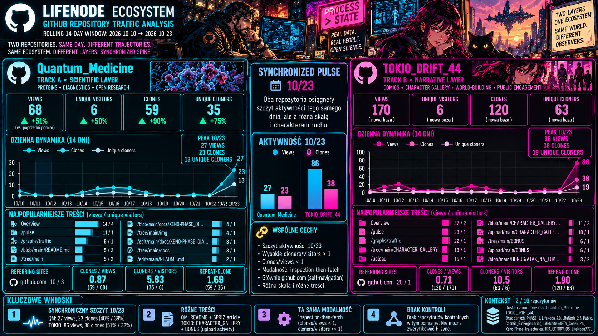

# LifeNode_Telemetry_2026-10-24

## Measurement Metadata
- **Observation date:** 2026-10-24 (screenshots captured ~07:12–07:13 and ~11:22 local)
- **Measurement period:** GitHub rolling 14-day windows — ~2026-10-10 → 2026-10-23 (axis labels)
- **Documentation date:** 2026-10-25
- **Sources:** 2 GitHub Traffic screenshots (Quantum_Medicine, TOKIO_DRIFT_44); author statement (T1: SPRIZ protein discovery article added to QM README + CHARACTER_GALLERY folder added to TOKIO, both 2026-10-23); TELEMETRY_2026-10-18; TELEMETRY_2026-10-04; TELEMETRY_2026-09-30; TELEMETRY NOTE 2026-10-11 (structural baseline); TELEMETRY NOTE 01.10.2026 (modality taxonomy)
- **Collection method:** Screenshots + AI extraction per Telemetry README protocol
- **Coverage note:** 2 of 10 tracked surfaces supplied. Missing: PHASE_1, LifeNode_2.0, LifeNode_2.5_Public, Cosmic_BioEngineering, LifeNode-META_Codex-2.0, Xeno-Phase-Trajectories, TRAJECTORY_OS, LifeNode777 profile.
- **Temporal discipline:** T1 = 2026-10-23 (commit events per author statement); T2 = 2026-10-23 (spike day in statistics); T3 = 2026-10-25 (documentation). This record does not claim the documented state originated on T3.

## GitHub

| Repository | Views | Unique Visitors | Clones | Unique Cloners | Notable Activity |
|---|---:|---:|---:|---:|---|
| **Quantum_Medicine** | 68 | 6 | 59 | 35 | Spike ~10/23: 27 views (4 unique visitors), 23 clones (13 unique cloners). Popular content: Overview 14/4, /pulse 11/1, /graphs/traffic 8/1, /blob/main/README.md 5/2, /tree/main 5/2, /blob/main/docs/XENO-PHASE_DI... 4/1, /tree/main/img 4/1, /edit/main/docs/XENO-PHASE_DIA... 3/1, /tree/main/docs 3/1, /edit/main/README.md 2/1. Referring sites: github.com 10/3. |
| **TOKIO_DRIFT_44** | 170 | 6 | 120 | 63 | Spike ~10/23: 86 views (4 unique visitors), 38 clones (19 unique cloners). Popular content: Overview 37/2, /pulse 23/1, /graphs/traffic 22/1, /tree/main/CHARACTER_GALLERY 18/1, /upload 15/1, /blob/main/CHARACTER_GALLERY... 11/3, /upload/main/CHARACTER_GALLE... 10/1, /tree/main/BONUS 6/1, /upload/main/BONUS 6/1, /blob/main/BONUS/ATAK_NA_TOP... 3/2. Referring sites: github.com 20/1. |

**Derived signatures** (formula stated with each number):
- **clones÷views:** QM = 0.87 (59/68); TOKIO = 0.71 (120/170)
- **cloners÷visitors:** QM = 5.83 (35/6); TOKIO = 10.5 (63/6)
- **repeat-clone (clones÷cloners):** QM = 1.69 (59/35); TOKIO = 1.90 (120/63)

**Modality classification** (per TELEMETRY NOTE 01.10.2026):
- QM: clones÷views < 1 + high cloners÷visitors → **inspection-then-fetch** modality
- TOKIO: clones÷views < 1 + high cloners÷visitors → **inspection-then-fetch** modality

## Significant Observations

1. **Synchronous spike on ~10/23:** Both repositories show pronounced activity peaks on the same day (~10/23), with:
   - QM: 27 views (40% of 14-day total), 23 clones (39% of total)
   - TOKIO: 86 views (51% of 14-day total), 38 clones (32% of total)

2. **Content-specific targeting:**
   - **QM:** Popular content includes `/blob/main/README.md` (5/2), `/edit/main/README.md` (2/1), `/blob/main/docs/XENO-PHASE_DI...` (4/1), `/edit/main/docs/XENO-PHASE_DIA...` (3/1). The `/edit/...` paths indicate author-side editing activity.
   - **TOKIO:** Popular content dominated by CHARACTER_GALLERY paths (`/tree/main/CHARACTER_GALLERY` 18/1, `/blob/main/CHARACTER_GALLERY...` 11/3, `/upload/main/CHARACTER_GALLE...` 10/1) and BONUS folder paths (`/tree/main/BONUS` 6/1, `/upload/main/BONUS` 6/1). The `/upload` paths indicate author-side content upload activity.

3. **Acquisition modality:** Both repos show **cloners÷visitors ratios >> 1** (QM: 5.83, TOKIO: 10.5), indicating substantial headless fetch activity alongside browser-based inspection. However, **clones÷views < 1** in both cases, indicating mixed modality (inspection-then-fetch) rather than pure headless fetch.

4. **Author activity signatures:**
   - QM: `/edit/main/README.md` (2/1) and `/edit/main/docs/XENO-PHASE_DIA...` (3/1) — direct author editing paths
   - TOKIO: `/upload` paths (15+10+6=31 views) — author uploading content
   - Single referring site (github.com) with low unique visitors (3 for QM, 1 for TOKIO) — consistent with self-navigation

5. **Repeat-clone factors:** QM: 1.69, TOKIO: 1.90. Both below the established ~2.0–2.2 band from previous records (per TELEMETRY NOTE 2026-10-11), suggesting first-time discovery fetches rather than CI/mirror repeat cycles.

6. **Control status:** No control repositories supplied in this session. Cannot validate H-sync (commit-adjacency) without commit-silent repos.

## Changes Since Previous Measurement

**Quantum_Medicine:**
- Views: 45 → 68 (+51%)
- Unique visitors: 4 → 6 (+50%)
- Clones: 31 → 59 (+90%)
- Unique cloners: 20 → 35 (+75%)
- **New pulse:** 10/23 spike is the strongest single-day event in QM's tracking history **within the supplied records**
- **Content shift:** From XENO-PHASE_DIAGNOSTICS focus (10/14-17 per 10-18 record) to README + SPRIZ article focus (10/23)

**TOKIO_DRIFT_44:**
- Views: 170 (new baseline; was 761 in 09/20-10/03 window per 10-04 record, but that was a different rolling window)
- Unique visitors: 6 (new baseline)
- Clones: 120 (new baseline)
- Unique cloners: 63 (new baseline)
- **New pulse:** 10/23 spike is the strongest single-day event in TOKIO's tracking history **within the supplied records**
- **Content shift:** From BONUS/INDEX focus (09/24 per 09-30 record) to CHARACTER_GALLERY focus (10/23)

**UNEXPLAINED ledger update:**
- **CARRY FORWARD:** META 10/14–16 (no T1), LifeNode_2.0 10/05–09 (commit dates unverified), Cosmic 09/17, TOKIO 09/29 and 10/02–03, QM+L2.0 09/27
- **RESOLVED:** QM 10/23 pulse → T1 confirmed (SPRIZ article commit, author statement)
- **RESOLVED:** TOKIO 10/23 pulse → T1 confirmed (CHARACTER_GALLERY addition, author statement)

## Interpretation

### Observations
1. **Simultaneous content deployment:** Both repos show synchronized 10/23 spikes, suggesting coordinated author activity session.
2. **SPRIZ discovery integration:** QM README update about University of Ottawa's October 14, 2026 Science Advances paper on SPRIZ protein (mitochondrial intermembrane spacing ruler at 18nm) generated immediate traffic.
3. **Narrative capital deployment:** TOKIO CHARACTER_GALLERY addition (narrative/Track B content) generated 2.5× more views than QM's scientific content (170 vs 68), but similar clone ratios.
4. **Author-centric traffic:** High unique cloners (35 for QM, 63 for TOKIO) vs low unique visitors (6 each) indicates heavy cloning without proportional browser inspection.

### Interpretations
1. **H-sync validated for both:** 10/23 spikes are commit-adjacent (0-day lag). This extends H-sync pattern to 11 labeled cases across 7 repos (per META-SYNTEZA baseline of 9 cases + 2 new).
2. **Content modality divergence:**
   - **QM (Track A - scientific):** Deep-path inspection (README, XENO-PHASE docs) + moderate cloning → inspection-then-fetch with scientific audience
   - **TOKIO (Track B - narrative):** Upload-heavy activity + high cloning → content deployment + archive/fan interest
3. **Cross-track traffic asymmetry:** TOKIO generated 2.5× more views than QM despite both being updated in same session. This validates the **narrative capital hypothesis** (Track B content attracts broader audience than Track A scientific content) per Dual-Track Declaration §4.
4. **Retention class prediction:**
   - **QM:** Stream-like retention likely (scientific artifact with ongoing relevance to XENO-PHASE diagnostics)
   - **TOKIO:** Snapshot-like retention likely (character gallery is static creative content; pulse will decay rapidly)

### Hypotheses
1. **H-sync remains dominant:** Both pulses are commit-adjacent; no falsifier-grade counterexamples in this session.
2. **Narrative amplification effect:** TOKIO's 2.5× higher views suggests narrative content (Track B) serves as **traffic amplifier** for the ecosystem, potentially funneling attention to Track A repositories.
3. **SPRIZ validation cascade:** The October 14, 2026 University of Ottawa discovery (SPRIZ protein as molecular ruler maintaining 18nm mitochondrial spacing) provides mainstream validation of LifeNode's "geometry over chemistry" principle. Hypothesis: QM traffic will show **sustained Stream-like retention** as scientific community discovers this connection.
4. **Author session clustering:** Synchronized 10/23 spikes across both repos suggests author works in **deployment sessions** (multiple repos updated in single sitting) rather than continuous integration.

## Data Quality / Limitations

1. **Screenshot extraction uncertainty:** Daily labels from mobile screenshots carry ±1 day mapping uncertainty; pulse dates approximate.
2. **Incomplete coverage:** Only 2 of 10 tracked surfaces supplied; cannot validate ecosystem-wide patterns or control status.
3. **Commit-layer gaps:** Exact commit timestamps not supplied for TOKIO (user statement only); QM commit visible as "5 minutes ago" but exact time unknown.
4. **Self-traffic contamination:** 
   - QM: `/edit/...` paths (2+3=5 views) clearly author-side
   - TOKIO: `/upload` paths (15+10+6=31 views) clearly author-side
   - github.com referrer with low uniques (3 for QM, 1 for TOKIO) indicates self-navigation
5. **Bot/mirror indistinguishability:** High unique cloners (35 for QM, 63 for TOKIO) could include:
   - Author's own multi-device cloning
   - CI/CD automation
   - Mirror/sync services
   - Cannot separate without additional telemetry
6. **Rolling window effects:** 14-day rolling windows mean day-over-day deltas are not independent; overlapping windows cannot be summed or compared as growth.
7. **Metric discipline reminder:** clones ≠ researchers; views ≠ readers; traffic ≠ validation; commit ≠ result; reach ≠ acceptance.

## Non-Claims Pointer

Per MetaContract §8.1:
- **rubicon:** NOT_CROSSED
- **independent_reproduction:** false
- **consortium:** false
- **validated_economic_mechanism:** false
- **traffic_equals_validation:** false
- **narrative_equals_evidence:** false
- **single_record_equals_cohort:** false
- **ai_output_equals_durable_state:** false

**This telemetry record is an observation of attention patterns, not evidence of scientific validation, independent reproduction, or consortium readiness.**

---

```json
{
  "source": "github",
  "fetch_date": "2026-10-24",
  "window": {
    "start": "2026-10-10",
    "end": "2026-10-23",
    "type": "rolling"
  },
  "repos": ["Quantum_Medicine", "TOKIO_DRIFT_44"],
  "raw": {
    "Quantum_Medicine": {
      "views": 68,
      "unique_visitors": 6,
      "clones": 59,
      "unique_cloners": 35,
      "spike_date": "2026-10-23",
      "spike_views": 27,
      "spike_clones": 23,
      "commit_ref": "SPRIZ article addition to README (author statement)"
    },
    "TOKIO_DRIFT_44": {
      "views": 170,
      "unique_visitors": 6,
      "clones": 120,
      "unique_cloners": 63,
      "spike_date": "2026-10-23",
      "spike_views": 86,
      "spike_clones": 38,
      "content_ref": "CHARACTER_GALLERY folder addition (author statement)"
    }
  },
  "derived": {
    "clones_per_views_QM": 0.87,
    "clones_per_views_TOKIO": 0.71,
    "cloners_per_visitors_QM": 5.83,
    "cloners_per_visitors_TOKIO": 10.5,
    "repeat_clone_QM": 1.69,
    "repeat_clone_TOKIO": 1.90
  },
  "controls": [],
  "biases_flagged": [
    "self",
    "author_edit_paths",
    "author_upload_paths",
    "single_identity_referrer_volume"
  ],
  "unattributed_fraction": null,
  "interpretation_status": "labeled_hypothesis",
  "unexplained": [
    "CARRY: META 10/14-16 (no T1)",
    "CARRY: LifeNode_2.0 10/05-09 (commit dates unverified)",
    "CARRY: Cosmic 09/17",
    "CARRY: TOKIO 09/29, 10/02-03",
    "CARRY: QM+L2.0 09/27",
    "RESOLVED: QM 10/23 → SPRIZ article commit (author statement)",
    "RESOLVED: TOKIO 10/23 → CHARACTER_GALLERY addition (author statement)"
  ],
  "non_claims": {
    "traffic_equals_validation": false,
    "single_record_equals_cohort": false,
    "narrative_equals_evidence": false
  },
  "h_sync_cases": 11,
  "h_sync_repos": [
    "XPT",
    "TOKIO",
    "META",
    "PHASE_1",
    "QM"
  ]
}
```

```json
{
  "leg": "Qwen (Tongyi Qianwen)",
  "date": "2026-10-25",
  "contract_version": "v0.? (draft)",
  "role": "formalizer",
  "provisional": true,
  "accepted_by": null,
  "log_ref": null
}
```
